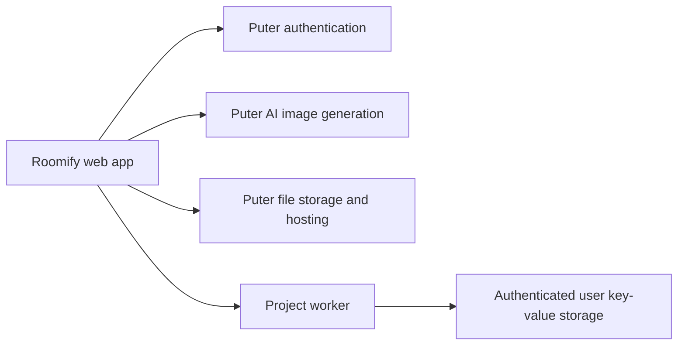

# Roomify

**Turn 2D floor plans into photorealistic interior visualizations.**

Roomify is an interior design SaaS project for exploring how a space could look before it is built. Upload a floor plan, generate an AI interpretation of its interior, compare the result with the original, and return to saved projects.

> **Status:** In active development. Authentication, uploads, image generation, comparison, export, and project persistence are implemented. Running the complete workflow requires a Puter account, a deployed project worker, and access to the selected image model.

## Features

- **Floor plan uploads** — Select or drag and drop JPG and PNG images up to 10 MiB. Upload processing requires sign-in.
- **AI interior rendering** — Send the source image and architectural rendering prompt to Puter's image-to-image API. The default model is `gemini-3.1-flash-image`, requested at a square aspect ratio and `1K` quality.
- **Before-and-after comparison** — Compare the source plan with the generated render using an interactive slider.
- **Regeneration and recovery** — Retry failed requests, regenerate an existing design, and reload projects when loading fails.
- **Project history** — Store project records through a serverless worker and reopen them from the home page.
- **Hosted assets and export** — Store source images and renders through Puter, and export the current render from the visualizer.
- **Application feedback** — Themed success, notice, and error notifications with keyboard dismissal, paused timers, and reduced-motion support.

## How It Works

1. Sign in with a Puter account.
2. Upload a JPG or PNG floor plan.
3. Roomify hosts the source image and saves a project record.
4. The visualizer loads the project and requests an AI render when one does not already exist.
5. The generated image appears in the preview and comparison slider, then is hosted and saved back to the project.
6. Export the result or choose **Regenerate** to request another interpretation.

If saving a generated image fails, the preview remains available for export and a notice explains that it was not saved. The upload progress indicator represents local file preparation; it is not progress reported by the AI provider.

## Architecture



The browser requests image generation through the Puter SDK. The serverless worker handles project records: saving, listing, and retrieving them. A separate background rendering queue is not implemented.

## Technology Stack

| Area | Technology |
| --- | --- |
| Interface | React 19 and TypeScript 5 |
| Application framework | React Router 8, with server-side rendering enabled |
| Styling | Tailwind CSS 4 |
| Development and builds | Vite 8 |
| Icons | Lucide React |
| Image comparison | React Compare Slider |
| Authentication, AI, storage, and workers | Puter.js |
| Web application runtime | Node.js |
| Containerization | Multi-stage Docker build using Node.js 24 Alpine |

## Getting Started

### Prerequisites

- Node.js 24, matching the included Docker image.
- npm.
- A Puter account with access to image generation and sufficient allowance.
- A deployed instance of the project worker described below.

### Install Dependencies

From the project directory:

```bash
npm ci
```

### Deploy the Project Worker

Deploy [lib/puter.worker.js](lib/puter.worker.js) in Puter's worker environment using the [Puter worker deployment API](https://docs.puter.com/Workers/create/). The source relies on Puter's `router` and authenticated `user.puter` context.

The worker provides these routes:

| Method | Route | Purpose |
| --- | --- | --- |
| `POST` | `/api/projects/save` | Save a project containing an ID and hosted source image. |
| `GET` | `/api/projects/list` | List project records from the authenticated user's storage. |
| `GET` | `/api/projects/get?id=<project-id>` | Retrieve a project by ID. |

Use the deployed worker's base URL in the configuration below. Deploying the web application does not deploy this worker.

### Configure the Environment

Create `.env.local` in the project root:

```dotenv
VITE_PUTER_WORKER_URL=https://your-worker-url
VITE_AI_IMAGE_MODEL=gemini-3.1-flash-image
```

Replace `https://your-worker-url` with the worker's base URL, without an `/api/projects/...` suffix.

| Variable | Required | Purpose |
| --- | --- | --- |
| `VITE_PUTER_WORKER_URL` | Yes, for uploads and project history | Base URL of the deployed project worker. |
| `VITE_AI_IMAGE_MODEL` | No | Image-to-image model ID. Defaults to `gemini-3.1-flash-image`. |

Puter manages account authentication; a provider API key is not required in the frontend. Generation uses the signed-in user's Puter allowance. For supported model IDs and image options, see the [Puter image generation documentation](https://docs.puter.com/AI/txt2img/).

`.env.local` is excluded from Git. `VITE_` variables are public client configuration and are embedded during the build, so use them for the worker URL and model ID rather than secrets. Restart development after changes and rebuild production bundles to apply them. See [Vite environment variables](https://vite.dev/guide/env-and-mode).

### Start Development

```bash
npm run dev
```

Open [http://localhost:5173](http://localhost:5173), or the address printed in the terminal, then sign in and upload a floor plan.

## Available Commands

| Command | Purpose |
| --- | --- |
| `npm run dev` | Start the development server. |
| `npm run typecheck` | Generate route types and run the TypeScript compiler. |
| `npm run build` | Build the production client and server bundles. |
| `npm start` | Serve an existing production build. |

Run `npm run typecheck` and `npm run build` before submitting changes. There is currently no committed automated test suite or `npm test` script.

## Project Structure

```text
roomify/
|-- app/
|   |-- routes/
|   |   |-- home.tsx                 # Landing page, uploads, and project history
|   |   `-- vizsualizer.$id.tsx      # Render generation, comparison, and export
|   |-- app.css                     # Theme and component styles
|   |-- root.tsx                    # Document layout, auth state, and toasts
|   `-- routes.ts                   # Route definitions
|-- components/
|   |-- toasts/                     # Notification store, provider, and helpers
|   |-- ui/Button.tsx               # Shared button component
|   |-- Navbar.tsx                  # Navigation and authentication controls
|   `-- Upload.tsx                  # File reading, validation, and progress
|-- lib/
|   |-- ai.action.ts                # Image-to-image generation and image reading
|   |-- constants.ts                # Configuration, timing, and rendering prompt
|   |-- puter.action.ts             # Authentication and project actions
|   |-- puter.hosting.ts            # Hosting configuration and asset storage
|   |-- puter.worker.js             # Serverless project API
|   `-- utils.ts                    # Image, URL, and error helpers
|-- public/                         # Static assets
|-- Dockerfile                      # Web application image
|-- package.json                    # Dependencies and scripts
`-- type.d.ts                       # Shared application types
```

## Production Deployment

Configure the public environment values before building. Changes made only to a running server's environment do not update an already-built frontend.

### Node.js

```bash
npm run build
npm start
```

The build produces static assets in `build/client` and server code in `build/server`. The start script serves `build/server/index.js`.

### Docker

The Dockerfile builds the application inside the image. Ensure the intended public configuration is available during that build, for example through the local `.env.local` in the build context.

```bash
docker build -t roomify .
docker run --rm -p 3000:3000 roomify
```

Open [http://localhost:3000](http://localhost:3000). The project worker remains a separate deployment in Puter.

## Troubleshooting

| Symptom | What to check |
| --- | --- |
| Upload does not start | Sign in, then select a JPG or PNG no larger than 10 MiB. |
| A project cannot be saved or loaded | Check `VITE_PUTER_WORKER_URL`, worker deployment, and account authentication. |
| `400` with `Model not found` | Choose a currently supported image model in `.env.local`; restart or rebuild the app. |
| Only the original image is visible | Read the visualizer's error message, resolve the reported issue, then choose **Try again**. |
| A render appears but is not saved | Check storage access and hosting, and export the preview before leaving the page. |
| Configuration changes have no effect | Restart development or create a new production build. |

For a failed service request, inspect its Network response body as well as its status code. Keep authentication tokens out of logs and bug reports.

## Current Limits and Roadmap

- Outputs are raster visualizations. Editable 3D models and CAD export are not implemented.
- **Share** and **Watch Demo** are placeholder controls.
- Project sharing and visibility enforcement remain unfinished; image assets use public hosting URLs.
- Durable background rendering jobs, billing, and a committed automated test suite remain future work.
